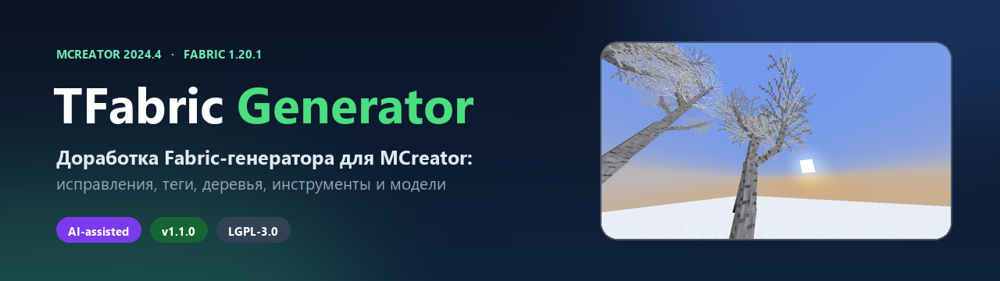
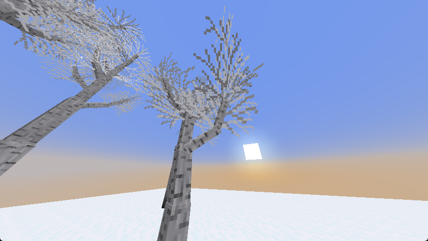

<p align="center">
  
</p>

<h1 align="center">TFabric-Generator-1.20.1</h1>

<p align="center">
  <b>Доработка Fabric-генератора для MCreator 2024.4</b><br>
  Исправления, теги, деревья, инструменты, модели и приятные мелочи —
  в одной самостоятельной сборке.
</p>

<p align="center">
  <a href="https://github.com/nodura1488-sudo/TFabric-Generator-1.20.1/releases">
    
  </a>
  
  
  
  
  
</p>

<p align="center">
  <a href="README_EN.md">English</a> ·
  <a href="https://github.com/nodura1488-sudo/TFabric-Generator-1.20.1/releases">Releases</a> ·
  <a href="CHANGELOG.md">Changelog</a> ·
  <a href="CONTRIBUTING.md">Contributing</a> ·
  <a href="https://github.com/nodura1488-sudo/TFabric-Generator-1.20.1/issues">Issues</a>
</p>

---

> **Коротко:** это **не ещё один генератор с нуля**, а доработанная сборка
> популярного Fabric-генератора для MCreator. Базовые шаблоны, структура
> проекта и совместимость с Fabric 1.20.1 сохранены — сверху добавлены
> исправления, новые элементы, теги и расширенная работа с моделями.
> Отдельный Fabric-генератор устанавливать не нужно: всё уже внутри.

## Чем отличается

| Обычный Fabric-генератор | TFabric-Generator |
| --- | --- |
| Базовые блоки, предметы и растения | Плюс исправления крашей и NPE, теги, лут-таблицы, тултипы |
| Саженцы без готового дерева | Генерация `TreeGrower` из настроек растения |
| Блоки попадают во все кастомные вкладки | Блоки регистрируются только в своих вкладках |
| OBJ-модели требуют ручной настройки | Автоматические манифесты и поддержка моделей «из коробки» |
| Нет готовой документации и CI | README, CONTRIBUTING, issue-шаблоны, GitHub Actions |

## Главные возможности

### 🛠️ Стабильность и исправления

- Исправлен `NullPointerException` при сохранении элементов-тегов
  (в генераторе не хватало `tags`-спецификации).
- Исправлен краш `BlockModel parent has to be a block model`.
- Исправлена регистрация блоков во **всех** кастомных креативных вкладках —
  теперь блок попадает только в выбранные.
- Аккуратная генерация тегов и лут-таблиц без ручных JSON-файлов.

### 🧱 Блоки

- Loot-таблицы блоков и растений.
- Теги уровней инструментов: `needs_stone_tool`, `needs_iron_tool`,
  `needs_diamond_tool`.
- Теги `stairs`, `slabs`, `fences`, `walls`, `leaves`, `replaceable`.
- Поддержка поворотов и состояний блока, хитбоксов, света, звуков и дропа —
  всё как в обычном генераторе.

### 🌱 Растения

- Саженцы с автоматически сгенерированным `TreeGrower` по настройкам дерева.
- Теги `saplings` и `replaceable`.
- `creativePickItem` — корректный предмет в креативном инвентаре.
- Двойные растения, тултипы и локализация.

### ⚔️ Предметы и инструменты

- Теги `pickaxes`, `axes`, `swords`, `shovels`, `hoes`.
- Тег `music_discs` для пластинок.
- Топливо и компост через Fabric API.
- Тултипы предметов и инструментов в lang-файлах.
- `onTick` для GUI через Fabric `ServerTickEvents`.

### 🧊 Модели

- OBJ-модели блоков, предметов, инструментов и брони — выбираются прямо
  в редакторе MCreator.
- Автоматическая привязка «элемент → модель → текстура», без ручного
  редактирования JSON.
- Несколько текстур на модель, отдельные трансформы для руки/GUI/земли,
  двусторонние грани и опциональное отсечение.
- Всё работает без стороннего runtime-мода: загрузчик уже в проекте.

### ⚡ Совместимость

- Fabric API 0.90.7+1.20.1, Fabric Loader 0.14.21.
- Проверено с **Sodium + Iris**: сложные модели не просвечивают и не
  разваливаются, опциональный culling не включён по умолчанию.
- Поддержка ветра BSL для листвы, травы и кустов (настраивается в
  `block.properties` шейдерпака).

## Как это выглядит

<p align="center">
  
</p>

## Установка

1. Скачай `TFabric-Generator-1.20.1.zip` со страницы
   [Releases](https://github.com/nodura1488-sudo/TFabric-Generator-1.20.1/releases).
2. Открой **MCreator → Preferences → Manage plugins → Install plugin from file**
   и выбери zip.
3. Перезапусти MCreator.

Можно и просто положить zip в `%USERPROFILE%\.mcreator\plugins`.

## Создание воркспейса

При создании нового воркспейса выбери генератор:

> **TFabric-Generator-1.20.1 for 1.20.1 - 0.90.7**

Старые воркспейсы, созданные на обычном `fabric-1.20.1`, автоматически не
переключаются. Для нового проекта просто выбери этот генератор. Если нужен
перенос — создай новый воркспейс и перенеси элементы.

## Обновление с 1.0.x

- Плагин можно устанавливать поверх старой версии.
- Существующие воркспейсы продолжают работать.
- После обновления перегенерируй проект, чтобы применились новые шаблоны.
- Подробности — в [CHANGELOG.md](CHANGELOG.md).

## Что нового в 1.1.0

- OBJ-модели для предметов, инструментов и брони.
- Мультитекстуры, трансформы и двусторонние грани.
- Culling теперь опциональный и по умолчанию выключен — сложные модели
  больше не теряют грани.
- Стабильная работа с Sodium/Iris.
- Новый README, скриншоты, CONTRIBUTING, issue-шаблоны и GitHub Actions.

## Ограничения

- `Attribute` и кастомные атрибуты сущностей — нужны миксины.
- `Fluid` — собственные жидкости (рендер, ведро, теги) — отдельный большой порт.
- Энергохранилища и жидкостные баки в блоках.
- Поиск по креативной вкладке — в Minecraft 1.20.1 у
  `CreativeModeTab.Builder` нет `withSearchBar`.
- OBJ-модель брони **на игроке** — поддерживается item-модель, не worn-модель.
- Emissive-текстуры OBJ — нужен кастомный render type/шейдер.

## Сборка из исходников

Нужен Python 3. Из корня репозитория:

```bash
python tools/validate_plugin.py
python build_zip.py
```

Готовый `TFabric-Generator-1.20.1.zip` появится в корне.

## Участие в разработке

См. [CONTRIBUTING.md](CONTRIBUTING.md). Баги и идеи — в
[Issues](https://github.com/nodura1488-sudo/TFabric-Generator-1.20.1/issues).
Для багов с рендером приложи `latest.log` и сгенерированные манифесты.

## Сделано с ИИ

Плагин разрабатывается в связке **человек + ИИ**:

- **ИИ-агент:** OpenCode + **DeepSeek V4.1 Flash** — пишет и правит шаблоны,
  Java-код, документацию, CI и тесты.
- **Человек:** ставит задачи, проверяет сборку в MCreator и запускает
  тестовые миры в Minecraft, принимает результат.

ИИ используется **только при разработке плагина**. В сгенерированные моды он
не попадает: там обычный Fabric-код, шаблоны MCreator и Fabric API.

## Лицензия и авторы

- Автор плагина: **Tommy_Whinston**
- Основа: **Minecraft Fabric 1.20.1 Generator** от **300f20t** и **Goldorion**
- Лицензия: **LGPL-3.0** — см. [LICENSE](LICENSE)
- Уведомления и исходные авторы: [NOTICE](NOTICE)

Отдельные шаблоны MCreator сохраняют свои copyright-заголовки и
распространяются на условиях MCreator template exception.
