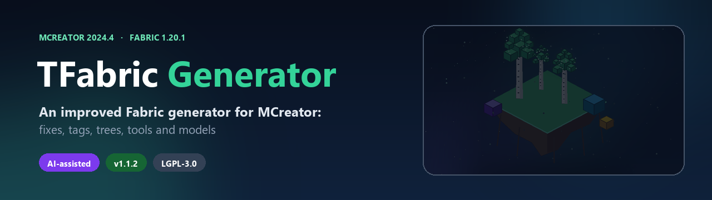

<p align="center">
  
</p>

> **Made with AI.** This plugin is developed by a human together with an AI
> assistant: code, templates, documentation and CI are written and edited with
> AI. AI is used only during plugin development and is not shipped into
> generated mods.

<h1 align="center">TFabric-Generator-1.20.1</h1>

<p align="center">
  <b>An improved build of the Fabric generator for MCreator 2024.4</b><br>
  Fixes, tags, trees, tools, models and quality-of-life features in one
  standalone add-on.
</p>

<p align="center">
  <a href="https://github.com/tommy-whinston/TFabric-Generator-1.20.1/releases">
    
  </a>
  
  
  
  
  
</p>

<p align="center">
  <a href="README.md">Русский</a> ·
  <a href="https://github.com/tommy-whinston/TFabric-Generator-1.20.1/releases">Releases</a> ·
  <a href="CHANGELOG.md">Changelog</a> ·
  <a href="CONTRIBUTING.md">Contributing</a> ·
  <a href="https://github.com/tommy-whinston/TFabric-Generator-1.20.1/issues">Issues</a>
</p>

---

> **Short version:** this is **not a generator written from scratch**. It is an
> improved build of the popular Fabric generator for MCreator. The base
> templates, project layout and Fabric 1.20.1 compatibility are preserved;
> fixes, new elements, tags and better model support are added on top.
> You do not need to install the regular Fabric generator separately.

## What is different

| Regular Fabric generator | TFabric-Generator |
| --- | --- |
| Basic blocks, items and plants | Plus crash/NPE fixes, tags, loot tables and tooltips |
| Saplings without a tree | Generates a `TreeGrower` from the plant settings |
| Blocks are added to every custom tab | Blocks are registered only in their own tabs |
| OBJ models need manual setup | Automatic manifests and out-of-the-box model support |
| No ready docs or CI | README, CONTRIBUTING, issue templates and GitHub Actions |

## Main features

### 🛠️ Stability and fixes

- Fixed a `NullPointerException` when saving tag elements (the generator was
  missing the `tags` specification).
- Fixed the `BlockModel parent has to be a block model` crash.
- Fixed blocks being registered in **every** custom creative tab.
- Clean tag and loot-table generation without hand-written JSON.

### 🧱 Blocks

- Block and plant loot tables.
- Tool-level tags: `needs_stone_tool`, `needs_iron_tool`,
  `needs_diamond_tool`.
- `stairs`, `slabs`, `fences`, `walls`, `leaves`, `replaceable`.
- Rotations, block states, hitboxes, light, sounds and drops work as usual.

### 🌱 Plants

- Saplings with an automatically generated `TreeGrower`.
- `saplings` and `replaceable` tags.
- `creativePickItem` support.
- Double plants, tooltips and localization.

### ⚔️ Items and tools

- `pickaxes`, `axes`, `swords`, `shovels`, `hoes` tags.
- `music_discs` tag for music discs.
- Fuel and compost support through Fabric API.
- Item and tool tooltips in language files.
- GUI `onTick` support through Fabric `ServerTickEvents`.

### 🧊 Models

- OBJ models for blocks, items, tools and armor, selected directly in the
  MCreator editor.
- Automatic element → model → texture binding, no manual JSON editing.
- Multiple textures per model, item/tool transforms, double-sided faces and
  optional face culling.
- No third-party runtime model mod: the loader is generated into the project.

### ⚡ Compatibility

- Fabric API 0.90.7+1.20.1, Fabric Loader 0.14.21.
- Tested with **Sodium + Iris**: complex models no longer show see-through
  gaps, and optional culling is disabled by default.
- BSL wind support for leaves, grass and bushes (configured in the shader
  pack's `block.properties`).

## Installation

1. Download `TFabric-Generator-1.20.1.zip` from
   [Releases](https://github.com/tommy-whinston/TFabric-Generator-1.20.1/releases).
2. Open **MCreator → Preferences → Manage plugins → Install plugin from file**
   and select the zip.
3. Restart MCreator.

You can also drop the zip into `%USERPROFILE%\.mcreator\plugins`.

## Creating a workspace

Select this generator when creating a new workspace:

> **TFabric-Generator-1.20.1 for 1.20.1 - 0.90.7**

Workspaces created with the plain `fabric-1.20.1` generator are not switched
automatically. Create a new workspace with this generator, or move the elements
into a new project.

## Updating from 1.0.x

- The plugin can be installed over the old version.
- Existing workspaces keep working.
- Regenerate the project after updating to apply the new templates.
- See [CHANGELOG.md](CHANGELOG.md) for details.

## What's new

**1.1.2**
- Blocks are added only to their assigned custom tabs, not to every custom tab.

**1.1.1**
- Fixed custom creative tabs: regenerated blocks are added to their tabs again.

**1.1.0**
- Stability: improved rendering and Sodium/Iris compatibility for complex
  models; culling is now opt-in and disabled by default.
- Models: OBJ for items, tools and armor, multiple textures, transforms and
  double-sided faces.
- Documentation: README rewritten from scratch, new banner, artwork,
  CONTRIBUTING and issue templates.
- CI: automatic plugin validation and release builds through GitHub Actions.

## Limitations

- `Attribute` and custom entity attributes require mixins.
- `Fluid` support (rendering, bucket, tags) is a separate large port.
- Energy and fluid storage in blocks.
- Creative tab search: Minecraft 1.20.1's `CreativeModeTab.Builder` has no
  `withSearchBar`.
- OBJ armor **worn** models: only the item model is supported.
- Emissive OBJ textures require a custom render type/shader.

## Building from source

Python 3 is required. From the repository root:

```bash
python tools/validate_plugin.py
python build_zip.py
```

The ready-to-install `TFabric-Generator-1.20.1.zip` will be created in the
repository root.

## Contributing

See [CONTRIBUTING.md](CONTRIBUTING.md). Report bugs and ideas in
[Issues](https://github.com/tommy-whinston/TFabric-Generator-1.20.1/issues).
For rendering bugs, attach `latest.log` and the generated manifests.

## License and credits

- Plugin author: **Tommy_Whinston**
- Based on the **Minecraft Fabric 1.20.1 Generator** by **300f20t** and
  **Goldorion**
- License: **LGPL-3.0** — see [LICENSE](LICENSE)
- Notices and original authors: [NOTICE](NOTICE)

Individual MCreator templates keep their original copyright headers and are
distributed under the MCreator template exception.
